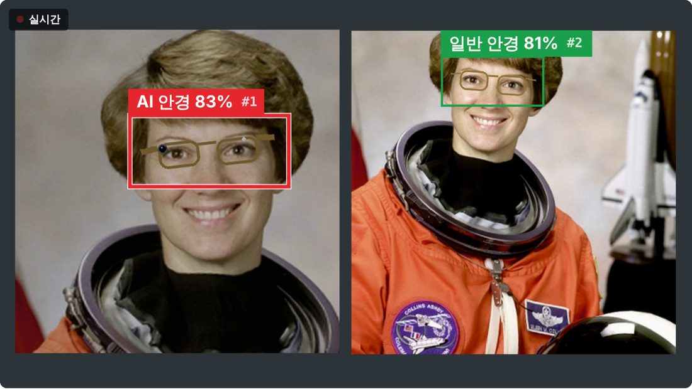

# AI 안경 판독기

시험 감독관이 카메라로 고사실을 비추면, 화면 속 **모든 응시자의 안경에 박스**를 그리고
그 안경이 **AI 안경(스마트 안경)** 인지 **일반 안경** 인지 확률과 함께 실시간으로 표시하는 웹 앱입니다.



| 박스 | 뜻 |
| --- | --- |
| 파란 박스 `안경 인식 · 판독 중` | 얼굴에서 안경 영역을 찾았고 판독하는 중 (프로그램이 어디를 보는지 표시) |
| 초록 박스 `일반 안경 93%` | 일반 안경 |
| 빨간 박스 `AI 안경 87%` / `AI 안경 의심 45%` | AI 안경이거나 의심됨. 감독관이 직접 확인 |
| 회색 얇은 박스 `안경 없음` | 안경을 쓰지 않음 (설정에서 숨길 수 있음) |
| 점선 박스 `멀어요 · 확대하세요` | 얼굴이 너무 작아 판독을 보류함. 확대하거나 다가가세요 |

- **기기 안에서만 동작합니다.** 영상은 서버로 전송되지 않습니다. 생성형 AI API나 토큰 비용이 없습니다. 직접 학습한 작은 분류 모델(약 70KB)을 씁니다.
- **오프라인으로 동작합니다.** 한 번 열면 인터넷이 없는 고사실에서도 동작합니다(서비스 워커 캐시).
- **정적 사이트입니다.** GitHub Pages에 그대로 올리면 됩니다. 휴대폰·태블릿·노트북 브라우저에서 엽니다.

> ⚠️ 저장소에는 **학습된 판독 모델(`web/models/head.json`)이 들어 있지 않습니다.**
> 실제 AI 안경 사진으로 직접 학습해야 판정과 확률이 나옵니다. 모델이 없으면 파란 박스(안경 영역 찾기)까지만 동작합니다.
> 앱의 **학습 데이터 수집** 기능으로 사진을 모으고 [모델 학습](#모델-학습)을 따라 하세요. 데이터 수집 요령은 [docs/DATA.md](docs/DATA.md)에 있습니다.

## 동작 방식

```
카메라 프레임 ─▶ ① 얼굴 찾기·추적 ─▶ ② 안경 영역 3곳 ─▶ ③ 이미지 임베딩 ─▶ ④ 분류기 ─▶ ⑤ 프레임 평균 ─▶ 박스·확률
                 (MediaPipe Face        · 안경 전체(박스)     (MobileNetV3-Large,  (로지스틱 회귀,   (사람마다 최근
                  Landmarker, 최대 8명)  · 양쪽 경첩           1280차원 × 2)        head.json)        10프레임)
```

1. **얼굴 찾기·추적:** 프레임마다 얼굴 랜드마크 478개를 찾습니다(최대 8명). 같은 사람에게는 프레임이 바뀌어도 같은 번호(#1, #2 …)를 붙입니다.
2. **영역 잘라내기:** 랜드마크로 세 영역을 잘라냅니다. 화면의 박스가 첫 번째 영역입니다.
   - 눈썹부터 광대 위까지, 얼굴 끝에서 끝까지의 **안경 전체**
   - 카메라형 AI 안경이 카메라와 LED를 두는 **양쪽 경첩 부근**. 설정의 ‘판독 영역 박스 보기’로 화면에 표시할 수 있습니다.
3. **특징 추출:** 각 영역을 MobileNetV3 임베더에 넣습니다. 특징은 `[안경 전체, 경첩 평균]`을 이어 붙인 2560차원입니다.
4. **분류:** 직접 학습한 로지스틱 회귀(`head.json`)가 `ai_glasses / regular_glasses / no_glasses` 확률을 냅니다.
5. **프레임 평균:** 한 사람당 최근 6초 안의 판독 결과 최대 10개를 평균합니다. 흔들림이나 반사 때문에 한 프레임이 틀려도 박스 색이 깜빡이지 않습니다.
   - 3번 이상 판독해야 판정이 안정된 것으로 봅니다.
   - 빨간 박스가 안정되면 **감독 기록에 자동으로 남고** 화면에 경고가 뜹니다. 설정에서 진동·경고음도 켤 수 있습니다.
   - 판독은 화면 속 사람을 차례로 돌아가며 합니다. 한 사람을 0.25초에 한 번보다 자주 판독하지는 않습니다.

학습(Python)과 판독(브라우저)은 **같은 모델 파일과 같은 영역 계산**을 씁니다.
`tests/test_pipeline.py --browser`가 두 쪽의 특징값과 확률이 일치하는지 확인합니다. 현재 차이는 0입니다.

## 화면 사용법

- **멈춤**(스페이스바): 현재 프레임을 멈추고 박스를 자세히 봅니다.
- **화면 저장**(S): 박스와 확률이 그려진 화면을 시각·고사실과 함께 JPG로 저장합니다. 이 기기에만 저장됩니다.
- **사진 판독:** 사진 파일을 같은 방식으로 판독합니다. 끌어다 놓기와 붙여넣기도 됩니다.
- **확대:** 휴대폰처럼 카메라가 광학·센서 줌을 지원하면 그것을 쓰고, 아니면 화면 가운데를 잘라 씁니다. 멀리 앉은 응시자는 확대해야 판독됩니다.
- **화면 속 응시자** 목록이나 박스를 누르면 그 사람의 상세 정보가 열립니다.
  - 모델이 실제로 본 영역(안경 전체·양쪽 경첩)과 클래스별 확률이 나옵니다.
  - 감독관이 할 조치가 나옵니다.
  - **기록에 남기기**와 **판정 정정** 버튼이 있습니다.

## 현장에서 모델을 계속 개선하기

정확도는 학습 사진의 양과 다양성에서 나옵니다. 이 앱은 사진을 모으고 고치는 과정까지 화면에서 할 수 있습니다.

1. **학습 데이터 수집** 칸을 엽니다.
   - 정답(AI 안경/일반 안경/안경 없음), 사람 ID, 안경 기종을 고릅니다.
   - **자동 수집 시작**을 누르면 0.6초마다 가장 큰 얼굴을 여백과 함께 잘라 모읍니다.
   - 동의한 사람에게 안경을 씌우고 정면·45°·측면, 1~3m 거리를 돌아가며 비추면 몇 분 만에 수백 장이 모입니다.
2. **판정이 틀렸을 때**는 그 사람을 골라 ‘판정이 틀렸나요?’에서 실제 정답을 누릅니다.
   - 모델이 틀린 장면이 학습 데이터에 담깁니다.
   - 이런 어려운 사례가 정확도를 가장 크게 올립니다.
3. **ZIP 내려받기**를 누릅니다. ZIP 안은 `ai_glasses/…jpg`, `regular_glasses/…jpg` 구조이고 `labels.csv`가 들어 있습니다.
4. 화면 위 **모델 학습**(`train.html`)을 열고 지금까지 모은 ZIP을 모두 끌어다 놓은 뒤 **학습 시작**을 누릅니다.
   - Python 설치 없이 브라우저 안에서 학습합니다. 사진은 기기 밖으로 나가지 않습니다.
   - 결과로 AI 안경 탐지율, 일반 안경 오탐률, 기준별 표, **틀린 사진 목록**이 나옵니다.
5. **이 기기에서 바로 사용**을 누르거나, **head.json 내려받기** 후 저장소에 올려 모든 기기에 배포합니다([아래](#모든-감독관-기기에-모델-배포)).

> “강화학습”처럼 현장에서 스스로 좋아지는 효과는 이 **수집 → 정정 → 재학습** 순환으로 얻습니다.
> 안경 분류처럼 정답이 분명한 문제는 지도학습이 더 정확하고 안정적입니다.
> 재학습은 사람이 결과(교차검증 수치)를 확인한 뒤 배포하므로, 잘못된 정정 하나가 모델을 망가뜨리지 않습니다.

## 바로 써 보기

```bash
cd web
python3 -m http.server 8000
# 브라우저에서 http://localhost:8000
```

카메라는 `https://` 또는 `localhost`에서만 켜집니다. 파일을 더블클릭해서 열면 동작하지 않습니다.

## GitHub Pages 배포

1. 이 저장소를 GitHub에 올립니다.
2. **Settings → Pages → Build and deployment → Source** 를 **GitHub Actions** 로 바꿉니다.
3. `main` 브랜치에 push하면 `.github/workflows/pages.yml`이 `web/` 폴더를 배포합니다.
   주소는 `https://<사용자>.github.io/<저장소>/` 입니다.

학습한 `head.json`을 `web/models/`에 넣고 push하면 모든 감독관이 같은 모델을 씁니다.
모델을 공개하고 싶지 않다면 배포에는 빼고, 각 기기에서 **판독 모델 → 모델 파일 불러오기**로 넣어도 됩니다.
불러온 모델은 그 브라우저에만 저장됩니다.

## 데이터와 모델은 어디에 두나

| 무엇 | 어디에 | 이유 |
| --- | --- | --- |
| 학습 사진 (얼굴 포함) | **감독관 PC에 ZIP으로 보관**, 웹의 모델 학습 페이지에 넣어 학습 | 개인정보입니다. 저장소(GitHub)에 올리지 않습니다 |
| 학습된 모델 `head.json` (숫자만) | **저장소 `web/models/head.json`** | 올리면 웹 주소로 접속하는 모든 기기가 자동으로 같은 모델을 씁니다 |

### 모든 감독관 기기에 모델 배포

1. 모델 학습 페이지에서 **head.json 내려받기**
2. GitHub 저장소 → `web/models` 폴더 → **Add file → Upload files** → `head.json` 올리고 **Commit changes** (main 브랜치)
3. 1~2분 뒤 GitHub Actions가 자동으로 다시 배포합니다. 감독관은 웹 주소를 새로 고치면 됩니다.

## 모델 학습

**웹에서 학습하기(권장):** 앱의 **모델 학습** 페이지(`train.html`)에 ZIP이나 `data` 폴더를 넣고 **학습 시작**을 누릅니다.
- 아래 Python 학습과 같은 특징, 같은 모델(scikit-learn과 같은 목적함수), 같은 교차검증 보고서를 냅니다.
- `tests/logreg_parity.py`와 `tests/train_e2e.cjs`로 같은 결과가 나오는지 확인합니다.
- 한 번 처리한 사진의 특징값은 브라우저(IndexedDB)에 저장되어 다음 학습 때는 새 사진만 처리합니다.

**Python으로 학습하기(선택):** 사진이 수만 장이거나 서버에서 돌리고 싶을 때 씁니다.

### 1. 환경

```bash
python3 -m venv .venv && source .venv/bin/activate
pip install -r training/requirements.txt
# Linux 서버라면 MediaPipe에 필요한 라이브러리: sudo apt-get install -y libegl1 libgles2
```

### 2. 데이터

```
data/
  ai_glasses/        AI 안경을 쓴 사람 사진        (필수)
  regular_glasses/   일반 안경을 쓴 사람 사진      (필수)
  no_glasses/        안경을 안 쓴 사람 사진        (선택, 권장)
```

얼굴이 보이는 사진이어야 합니다. 얼굴을 찾지 못한 사진은 자동으로 빠집니다.
**클래스당 최소 200장, 가능하면 500장 이상**을 권장합니다. 무엇을 어떻게 모을지는 [docs/DATA.md](docs/DATA.md)에 정리했습니다.
`data/` 폴더는 `.gitignore`에 들어 있습니다. 사람 얼굴 사진을 공개 저장소에 올리지 마세요.

### 3. 학습

```bash
python training/train.py --data data --out web/models/head.json --note "2026-11 1차 수집 / 고사장 촬영"
```

- 사진과 좌우 반전본으로 특징을 뽑습니다. 결과는 `data/.feature_cache.npz`에 캐시되어 다시 학습할 때 빠릅니다.
- 5겹 교차검증으로 정규화 강도를 고르고 결과를 출력합니다. 원본과 반전본은 같은 겹에 묶입니다.
- 출력 항목은 정확도, AI 안경 재현율·정밀도, 혼동행렬입니다.
- 마지막으로 전체 데이터로 학습해 `head.json`을 저장합니다. 교차검증 결과도 파일에 같이 기록되어 웹 앱의 **판독 모델** 칸에 표시됩니다.

판정 기준은 학습할 때 바꿀 수 있습니다.

```bash
python training/train.py ... --ai-threshold 0.6 --suspect-threshold 0.3
```

AI 안경 확률이 `--ai-threshold` 이상이면 **AI 안경**, `--suspect-threshold` 이상이면 **AI 안경 의심**으로 판정합니다. 둘 다 빨간 박스입니다.
감독 현장에서는 놓치는 것(미탐)이 더 위험하므로 의심 기준을 낮게 두는 편을 권합니다.

**`--target-recall 0.95`** 를 주면 의심 기준을 자동으로 정합니다. 교차검증에서 AI 안경 사진의 95% 이상이 빨간 박스로 잡히는 가장 높은 기준을 고릅니다.
학습이 끝나면 기준별로 “AI 안경 탐지율 / 다른 사람 오탐률” 표가 출력됩니다. 같은 수치가 웹 앱의 **판독 모델** 칸에도 표시됩니다.
이 수치는 사진 1장 기준입니다. 실시간 화면은 여러 프레임을 평균하므로 보통 더 좋습니다.

### 4. 확인

```bash
python training/predict.py 새사진1.jpg 새사진2.jpg --head web/models/head.json
python training/predict.py data/ai_glasses/*.jpg --save-crops /tmp/crops   # 잘라낸 영역 눈으로 확인
```

## 테스트

```bash
python tests/test_pipeline.py            # 합성 데이터 → 학습 → 예측
python tests/test_pipeline.py --browser  # + 브라우저와 결과가 같은지, 가짜 웹캠으로 실시간 화면 검사 (Node + Playwright 필요)
node --test tests/tracker.test.mjs        # 추적·평균·ZIP 단위 테스트
python tests/logreg_parity.py             # 브라우저 학습(web/logreg.js) == scikit-learn
```

`tests/make_synthetic.py`는 scikit-image에 포함된 공개 사진에 만화 같은 안경을 그려 **배관 점검용** 데이터를 만듭니다.
이 데이터로 학습한 모델은 실제 판독에 쓸 수 없습니다.
`--browser` 테스트는 두 사람이 나란히 있는 가짜 웹캠 영상(`tests/make_fake_camera.py`)을 Chromium에 넣습니다.
그리고 왼쪽이 빨간 박스, 오른쪽이 초록 박스로 판정되는지, 자동 기록과 학습 데이터 ZIP이 제대로 만들어지는지 확인합니다.

## 폴더 구조

```
web/                      GitHub Pages로 배포되는 정적 앱
  index.html, app.js      실시간 화면·박스 그리기, 사진 판독, 기록, 학습 데이터 수집
  pipeline.js             판독 파이프라인 (training/glasses_features.py 와 1:1 대응)
  tracker.js              얼굴 추적, 박스 흔들림 보정, 프레임 평균
  zip.js                  학습 데이터 ZIP 만들기
  train.html, train.js    브라우저 안 모델 학습 페이지
  logreg.js, train-worker.js  로지스틱 회귀(L-BFGS)·교차검증 (Web Worker)
  unzip.js                ZIP 읽기
  sw.js                   오프라인 캐시
  models/                 face_landmarker.task, mobilenet_v3_large.tflite, (head.json)
  vendor/                 @mediapipe/tasks-vision 1.2.2 런타임 (wasm 포함)
training/
  glasses_features.py     영역 계산·특징 추출 (웹과 동일)
  train.py                학습 + 교차검증 + head.json 내보내기
  predict.py              명령줄 판독
tests/                    합성 데이터·가짜 웹캠 생성, 파이프라인·브라우저 일치, 실시간 화면 E2E, 단위 테스트
scripts/fetch_assets.sh   MediaPipe 런타임·모델 다시 받기 (버전 올릴 때)
docs/DATA.md              학습 데이터 수집 가이드
```

## 한계와 주의

- **보조 도구입니다.** 판정은 확률이며 틀릴 수 있습니다. 의심되면 감독관이 안경을 직접 확인하세요.
- **데이터가 성능을 정합니다.** 모은 데이터에 없는 기종, 각도, 조명에서는 성능이 떨어집니다. 새 기종이 나오면 사진을 추가해 다시 학습하세요.
- **카메라가 보이지 않는 기종은 어렵습니다.** 스피커만 있는 오디오 안경(Echo Frames, Bose 등)과 디스플레이만 있는 안경은 외형 차이가 작습니다. 테 두께, 다리 모양, 렌즈 반사 같은 단서에 기대게 되므로 이런 기종의 사진을 특히 많이 모아야 합니다.
- **멀리 있는 얼굴은 판독하지 않습니다.** 얼굴 너비가 설정값(기본 88px)보다 작으면 점선 박스로 보류합니다. 작은 얼굴로 억지로 판정하면 오판이 늘기 때문입니다. 교실 뒤쪽은 확대하거나 걸어가며 비추세요.
- **처리 속도는 기기에 따라 다릅니다.** 최근 노트북·휴대폰에서는 초당 10~30프레임 정도입니다. 설정의 ‘처리 속도 표시’로 확인할 수 있습니다.
- **개인정보:** 응시자 촬영은 각 시험의 규정과 개인정보 보호 지침을 따르세요.
  - 앱은 영상을 저장하거나 전송하지 않습니다.
  - 감독 기록에는 안경 부분의 작은 썸네일만 그 브라우저에 남고, **비우기**로 지울 수 있습니다.
  - **학습 데이터 수집**은 사진을 찍히는 사람의 동의를 받은 뒤에만 쓰세요.

## 라이선스

- 이 저장소의 코드: [MIT](LICENSE)
- `web/vendor/`(MediaPipe Tasks Vision)와 `web/models/`의 MediaPipe 모델: Apache License 2.0, Google. [THIRD_PARTY_NOTICES.md](THIRD_PARTY_NOTICES.md)를 보세요.
